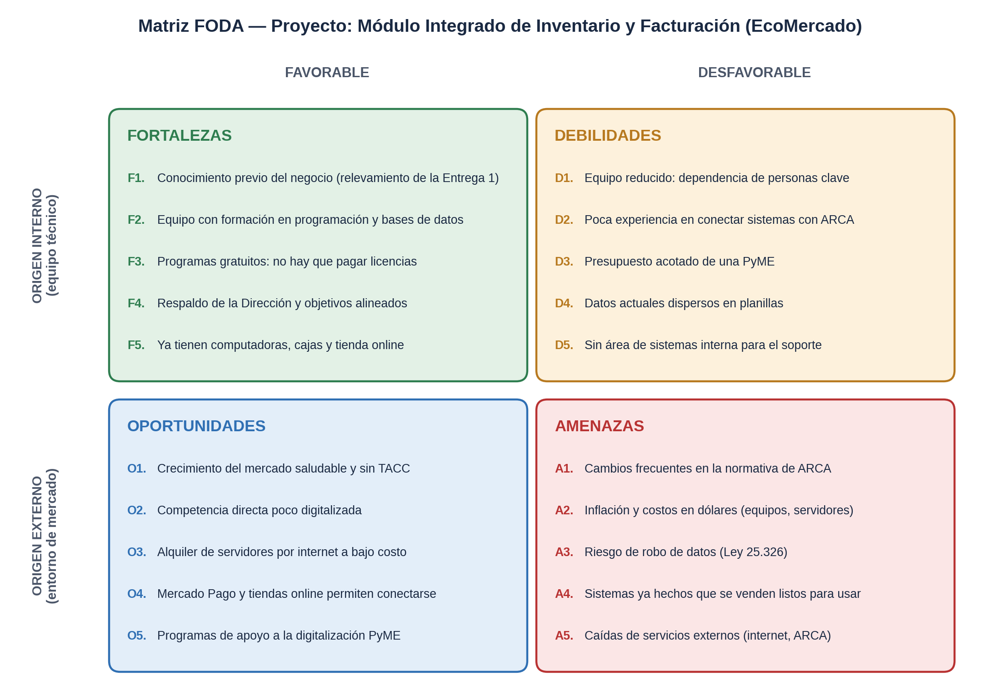
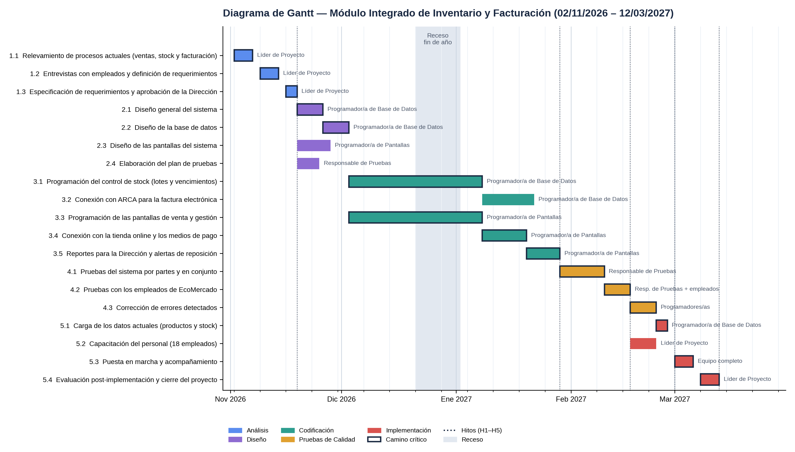

# 2. Planificación del proyecto (Entrega 2)

## Análisis FODA del proyecto

Conclusión: el proyecto es **viable**. Los riesgos principales (integración con ARCA, migración de datos y presupuesto) se gestionan con estrategias FO, DO, FA y DA.

## Metas cuantitativas (base de los estándares de control)

| N.º | Meta |
|---|---|
| M1 | Registrar una venta y descontar el stock en ≤ 2 s en el 95 % de las operaciones |
| M2 | Actualizar el stock de la web en ≤ 60 s después de cada venta en el local |
| M3 | Emitir la factura en ≤ 10 s y facturar el 100 % de las ventas sin carga manual |
| M4 | Funcionar con ≥ 5.000 productos y 300.000 ventas por año sin perder velocidad |
| M5 | Diferencia entre stock físico y registrado < 2 % a los 3 meses |
| M6 | Puesta en marcha el 01/03/2027 y cierre el 12/03/2027 |
| M7 | Capacitar al 100 % de los 18 empleados antes de la puesta en marcha |

## Diagrama de Gantt

84 días hábiles (02/11/2026 al 12/03/2027). Hitos: H1 requerimientos aprobados (18/11) · H2 fin de codificación (28/01) · H3 aprobación de los empleados (16/02) · H4 puesta en marcha (01/03) · H5 cierre (12/03).

📄 Documento completo: [`Entrega2_EcoMercado_Rouvier.pdf`](Entrega2_EcoMercado_Rouvier.pdf)
