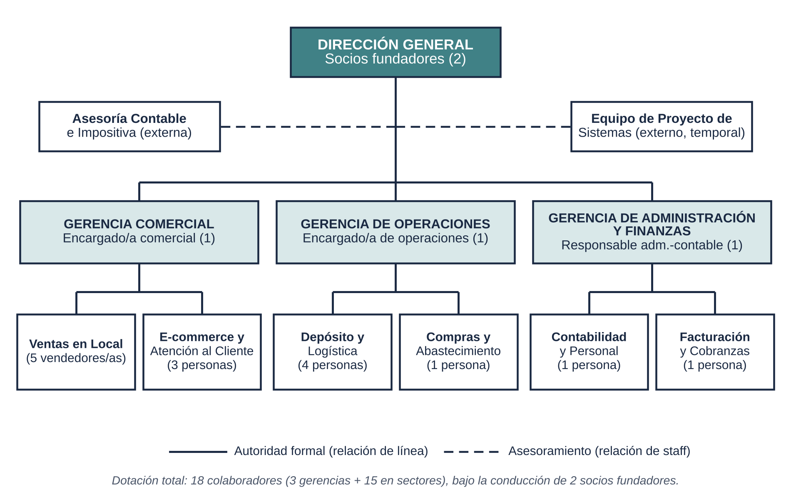
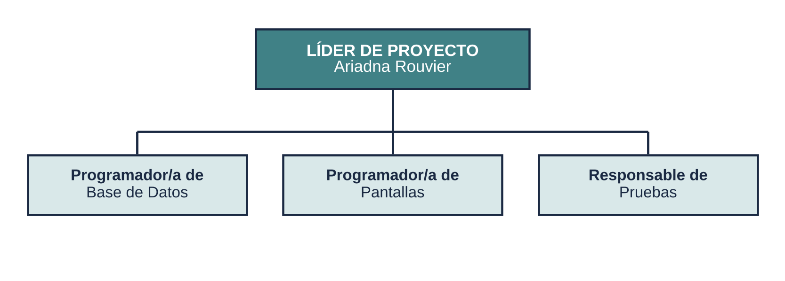

# 3. Organización y diseño de datos (Entrega 3)

## Organigrama de EcoMercado

Estructura **lineal con staff** y departamentalización funcional, con tres niveles: Dirección General, tres gerencias (Comercial, Operaciones y Administración y Finanzas) y seis sectores. El **Equipo de Proyecto de Sistemas** es staff temporal de la Dirección.

## Diccionario de datos (entidades)

| Entidad | Qué representa |
|---|---|
| PRODUCTO | Cada artículo del catálogo (precio, IVA, stock mínimo, sin TACC) |
| LOTE | Cada partida con su vencimiento; el stock real se calcula sumando los lotes |
| CLIENTE | Quien compra (documento y condición de IVA para la factura) |
| VENTA | Cada operación, del local o de la web (canal, medio de pago, estado) |
| DETALLE_VENTA | Cada renglón de la venta, con el lote del que salió la mercadería |
| FACTURA | Comprobante electrónico con CAE de ARCA (Autorizada, Pendiente o Rechazada) |

Estas entidades son las que aparecen en el diagrama BPMN ([`04-proceso-bpmn.md`](04-proceso-bpmn.md)) y en las historias de usuario.

📄 Documento completo: [`Entrega3_EcoMercado_Rouvier.pdf`](Entrega3_EcoMercado_Rouvier.pdf)
